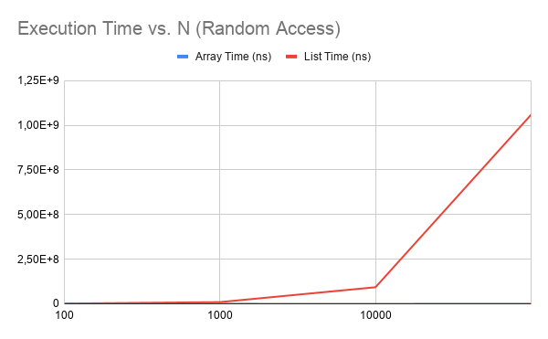
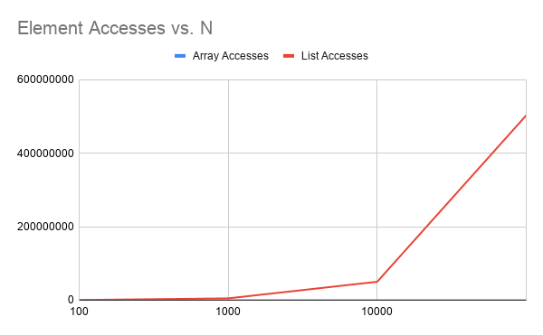

# Assignment 2: Algorithmic Analysis, Correctness and Performance Trade-offs

## 1. Overview
This project implements and analyzes three fundamental data structures from scratch: Dynamic Array, Linked List, and Min-Heap. The objective is to evaluate their algorithmic complexity, prove their correctness using loop invariants, and compare their theoretical performance against empirical benchmarks under four specific workloads.

## 2. Complexity Analysis

| Data Structure | Operation | Best Case | Average Case | Worst Case | Auxiliary Space | Justification |
| :--- | :--- | :--- | :--- | :--- | :--- | :--- |
| **Dynamic Array** | `get(i)` | $\Omega(1)$ | $\Theta(1)$ | $O(1)$ | $O(1)$ | Direct memory access via index calculation. |
| | `add(x)` | $\Omega(1)$ | $\Theta(1)$* | $O(n)$ | $O(1)$ | *Amortized $O(1)$. In the worst case (array full), resizing requires copying $n$ elements. |
| | `add(index, x)`| $\Omega(1)$ | $\Theta(n)$ | $O(n)$ | $O(1)$ | Elements from `index` to the end must be shifted right. |
| | `remove(index)`| $\Omega(1)$ | $\Theta(n)$ | $O(n)$ | $O(1)$ | Elements from `index+1` to the end must be shifted left. |
| | `contains(x)` | $\Omega(1)$ | $\Theta(n)$ | $O(n)$ | $O(1)$ | Linear scan. Best case $O(1)$ if the item is at index 0. |
| **Linked List** | `get(i)` | $\Omega(1)$ | $\Theta(n)$ | $O(n)$ | $O(1)$ | Must traverse nodes sequentially starting from the head. |
| | `add(x)` | $\Omega(n)$ | $\Theta(n)$ | $O(n)$ | $O(1)$ | Without a tail pointer, we must traverse $n$ nodes to reach the end. |
| | `add(index, x)`| $\Omega(1)$ | $\Theta(n)$ | $O(n)$ | $O(1)$ | Traversing to the given index takes $O(n)$ time. Insertion itself is $O(1)$. |
| | `remove(index)`| $\Omega(1)$ | $\Theta(n)$ | $O(n)$ | $O(1)$ | Traversing to the node takes $O(n)$ time. Unlinking is $O(1)$. |
| | `contains(x)` | $\Omega(1)$ | $\Theta(n)$ | $O(n)$ | $O(1)$ | Linear scan through the linked nodes. |
| **Min-Heap** | `insert(x)` | $\Omega(1)$ | $\Theta(\log n)$ | $O(\log n)$ | $O(1)$ | `siftUp` traverses the height of the tree, which is bounded by $\log n$. |
| | `peekMin()` | $\Omega(1)$ | $\Theta(1)$ | $O(1)$ | $O(1)$ | The minimum element is always at the root `data[0]`. |
| | `extractMin()`| $\Omega(\log n)$ | $\Theta(\log n)$ | $O(\log n)$ | $O(1)$ | `siftDown` traverses the height of the tree ($\log n$) after swapping the root with the last element. |

## 3. Correctness (Loop Invariants)

### Proof 1: `DynamicArray.contains(int x)`
*   **Loop Invariant:** At the start of iteration `i`, the target value `x` is not present in the subarray `data[0 ... i-1]`.
*   **Initialization:** Before the loop starts (`i = 0`), the subarray `data[0 ... -1]` is empty. Thus, it is vacuously true that `x` is not in this empty subarray.
*   **Maintenance:** Inside the loop, we check if `data[i] == x`. If it is, the loop terminates early. If the loop continues to iteration `i+1`, it means `data[i] != x`. Since `x` was not in `data[0 ... i-1]` (by hypothesis) and is not `data[i]`, it is not in `data[0 ... i]`. The invariant holds.
*   **Termination:** The loop terminates in one of two ways: either `data[i] == x` (returns `true`), or `i == size` (returns `false`). If `i == size`, the invariant states `x` is not in `data[0 ... size-1]`.
*   **Conclusion:** At termination, the algorithm correctly returns `true` if the element was found, and `false` if the entire array was checked and the element was absent, proving functional correctness.

### Proof 2: `MinHeap.siftUp(int index)`
*   **Loop Invariant:** At the start of each iteration, the binary tree satisfies the Min-Heap property everywhere, except possibly between the current `index` and its `parent`.
*   **Initialization:** Before the loop, a new element is appended at the very end of a valid Min-Heap. The rest of the tree is valid. The only potential violation is between the newly added node at `index` and its `parent`.
*   **Maintenance:** Inside the loop, we compare `data[index]` with `data[parent]`. If `data[index] < data[parent]`, a violation exists, so we swap them. After the swap, the former parent is now smaller than its children, fixing the local violation. However, the swapped element might now be smaller than its new parent. Thus, the only possible violation moves up to the new `index` and its parent, preserving the invariant for the next iteration.
*   **Termination:** The loop terminates when `index == 0` (the element has reached the root and has no parent) or when `data[index] >= data[parent]` (no violation exists).
*   **Conclusion:** At termination, the single possible violation has been resolved without introducing new ones. The entire tree is a valid Min-Heap, proving the operation's correctness.

## 4. Experimental Setup
*   **Values of n:** 100, 1000, 10000, 100000.
*   **Values of m:** 10,000 accesses for Workload 1; 1,000 accesses for Workloads 2 and 3.
*   **Repetitions:** 5 runs per configuration to smooth out OS-level interruptions.
*   **Timing Method:** `System.nanoTime()`. Time spent generating random data and resetting structures was strictly excluded from measurements.
*   **Random Seed:** `42` (Fixed to ensure reproducibility across runs).

## 5. Results
**Plot 1: Execution Time vs. N**

**Plot 2: Accesses vs. N**

### Additional Benchmarks

**Workload 3: Insertion and Removal (ns)**

| N | Insert 0 Array | Insert 0 List | Remove 0 Array | Remove 0 List | Insert n/2 Array | Insert n/2 List | Remove n/2 Array | Remove n/2 List |
| :--- | :--- | :--- | :--- | :--- | :--- | :--- | :--- | :--- |
| 100 | 1905720 | 90680 | 3378240 | 44460 | 1230020 | 140180 | 1473500 | 105260 |
| 1000 | 281560 | 46700 | 242300 | 40580 | 158320 | 928160 | 124540 | 886540 |
| 10000 | 1572900 | 44600 | 1282740 | 7240 | 855220 | 11856560 | 635220 | 10564260 |
| 100000 | 18428400 | 9600 | 7829680 | 3420 | 3519560 | 90936020 | 5834720 | 87049740 |

**Workload 4: Priority Processing (Min-Heap)**

| N | Insert Time (ns) | Extract Time (ns) | Valid Order |
| :--- | :--- | :--- | :--- |
| 100 | 47840 | 124420 | true |
| 1000 | 131300 | 179400 | true |
| 10000 | 795300 | 1235980 | true |
| 100000 | 3163180 | 14251900 | true |

## 6. Discussion
The empirical results closely matched the theoretical Big-O predictions:
*   **Workload 1 (Random Access):** The Dynamic Array execution time remained constant $\Theta(1)$ regardless of $n$, while the Linked List execution time grew linearly $O(n)$ due to traversal overhead. This perfectly matches the theoretical `get()` complexities.
*   **Workload 3 (Insertion/Removal):** The Linked List severely underperformed when inserting in the middle ($n/2$) due to the $O(n)$ traversal required to find the insertion node. While the array requires $O(n)$ shifting, memory locality and CPU caching make this shifting significantly faster in practice than traversing a Linked List.
*   **Workload 4 (Priority Processing):** The Min-Heap successfully processed elements in strictly non-decreasing order. The extraction time scaled logarithmically $O(\log n)$, confirming the efficiency of the `siftDown` tree traversal compared to a linear array search.

## 7. Design Recommendations
*   **Dynamic Array:** Preferable for workloads requiring frequent random element accesses (Workload 1) or searches (Workload 2). Its contiguous memory layout provides excellent cache locality, making operations generally faster than node-based structures despite equivalent Big-O shifting costs.
*   **Linked List:** Useful strictly when the workload relies heavily on insertions and deletions at the absolute beginning of a collection, or when memory reallocation pauses (Dynamic Array resizing) are unacceptable for real-time systems.
*   **Min-Heap:** The definitive choice for priority-based processing (Workload 4). It maintains the minimum element in $O(1)$ and balances insertion/extraction in $O(\log n)$, completely avoiding the $O(n \log n)$ overhead of keeping a standard array fully sorted.

## 8. Conclusion
This assignment demonstrated that while Big-O notation is crucial for predicting algorithmic scaling, constant factors and hardware-level implementation details (like CPU cache locality in contiguous arrays versus scattered Linked List nodes) heavily influence real-world performance. The Min-Heap proved mathematically and empirically optimal for maintaining dynamic priority queues.